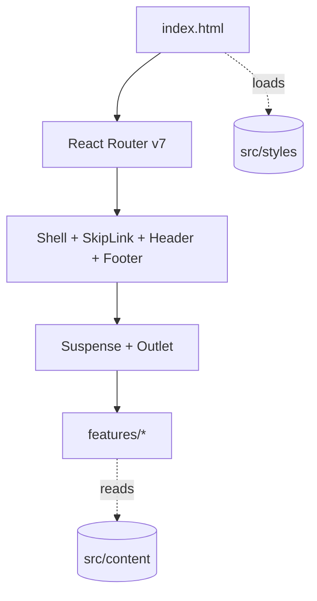

# Architecture Overview

## System shape

## Folder contract

- `src/app/` - router and providers.
- `src/components/ui/` - presentational atoms.
- `src/components/layout/` - Shell, Header, Footer.
- `src/features/` - one folder per route.
- `src/content/` - typed data source (the contract).
- `src/lib/` - pure utilities.
- `src/styles/` - tokens, reset, global.
- `docs/adr/` - Architecture Decision Records.
- `scripts/` - build-time helpers.
